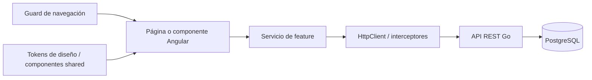

<div align="center">

# EDUTRAK · Frontend

### Interfaz web de seguimiento académico y acompañamiento tutorial

[](https://angular.dev/)


**[Organización](https://github.com/EDUTRAKMX)** · **[Backend](https://github.com/EDUTRAKMX/EDUTRAK_BACKEND)** · **[Prototipos Figma](https://www.figma.com/design/6XQ9NdLBIaU6ncl1KT32LF/EDUTRAK?node-id=0-1)**

</div>

> **Aviso de alcance:** este repositorio está destinado al frontend Angular de EDUTRAK. La arquitectura, rutas y estructura detalladas a continuación son **especificaciones de la Unidad 2**, no afirmaciones de que el código ya exista. Actualizar este README conforme se implementen y prueben los módulos.

## 1. Propósito

Construir la interfaz web de EDUTRAK para que **Alumnos, Profesores, Tutores, Directores de Carrera y Administradores** puedan utilizar los procesos académicos de acuerdo con sus permisos. El frontend se encargará de presentación, navegación, formularios, retroalimentación y comunicación con la API del backend Go.

La **autorización real siempre pertenece al backend**; ocultar botones o proteger rutas en Angular no reemplaza verificar permisos en el servidor.

## 2. Stack elegido y enfoque

| Área | Tecnología / decisión |
| --- | --- |
| Framework | **Angular** con TypeScript. |
| Componentes | **Standalone components** y reutilización. |
| Organización | Arquitectura **feature-based**. |
| Navegación | Angular Router, rutas por funcionalidad y carga diferida. |
| Formularios | **Reactive Forms** con validación cliente. |
| HTTP | `HttpClient` y contratos tipados con la API Go. |
| Estado | Estado local y **Signals** cuando corresponda; **RxJS** para procesos asíncronos. |
| UI/UX | Sistema visual documentado en Figma; responsive escritorio/móvil. |
| Pruebas | Tests de componentes, servicios, guards y validaciones (herramienta concreta por definir al crear el proyecto). |

No se ha fijado una versión exacta de Angular ni una librería global de estado; se documentarán tras crear y validar el proyecto.

## 3. Diseño y prototipos

**[Ver diseño de EDUTRAK en Figma](https://www.figma.com/design/6XQ9NdLBIaU6ncl1KT32LF/EDUTRAK?node-id=0-1)**

La implementación debe mantener la identidad de los prototipos. La guía preliminar documentada en la Unidad 1 incluye:

| Token | Valor propuesto |
| --- | --- |
| Primario | `#029A7B` |
| Primario claro | `#6CC8B4` |
| Burgundy / acento | `#8A2D40` |
| Fondo | `#F6F8F8` |
| Superficie | `#FFFFFF` |
| Texto principal | `#17201F` |
| Borde | `#D9E3E0` |
| Tipografía | **Inter** |
| H1 / H2 | **32 px Bold** / **24 px Semibold** |
| Cuerpo / caption | **14 px Regular** / **12 px Medium** |
| Iconos | **Lucide**, según los prototipos. |

Estas decisiones provienen del **kit de diseño propuesto**; cualquier cambio debe contrastarse con Figma y registrarse en la documentación. Verificar responsive al menos a **375, 390 y 430 px**, además de escritorio.

## 4. Módulos y vistas previstas

| Feature | Vistas / responsabilidades |
| --- | --- |
| `identity` | Inicio de sesión, perfil, cambio de contraseña, acceso denegado. |
| `academic` | Periodos, grupos, materias, asignaciones y horarios según rol. |
| `attendance` | Sesiones, visualización QR, lectura NFC cuando aplique, registro manual, estados y resumen. |
| `grades` | Captura y consulta de notas por unidad, promedios y categorías NA/SA/DE/AU. |
| `justifications` | Solicitudes, adjuntos, historial, revisión del Tutor y resolución del Profesor. |
| `tutoring` | Alumnos, observaciones, acuerdos, seguimiento y alertas. |
| `analytics` | Dashboards e indicadores explicables. |

**Roles:** Administrador, Director de Carrera, Profesor, Tutor y Alumno. Cada perfil tendrá navegación y pantallas específicas basadas en permisos y relación con los recursos.

## 5. Arquitectura frontend propuesta

Se organizará el proyecto **por funcionalidades**, separando configuración transversal, elementos reutilizables y procesos académicos. La estructura es una propuesta inicial a ajustar al código real:

```text
src/
└── app/
    ├── core/
    │   ├── auth/             # Estado de sesión, guards y permisos de navegación
    │   ├── http/             # Interceptores, errores y cliente API
    │   └── config/           # Configuración de la aplicación
    ├── shared/
    │   ├── components/       # Cards, botones, inputs, tablas, estados vacíos
    │   ├── pipes/
    │   └── utils/
    ├── layouts/              # Shell y navegación por rol, escritorio y móvil
    ├── features/
    │   ├── identity/
    │   ├── academic/
    │   ├── attendance/
    │   ├── grades/
    │   ├── justifications/
    │   ├── tutoring/
    │   └── analytics/
    ├── app.routes.ts
    └── app.config.ts
```

Dentro de una feature se podrán usar `pages/`, `components/`, `services/`, `models/` y `state/` **solo cuando el módulo lo necesite**. Evitar dependencias directas entre features; mover a `shared/` únicamente las piezas que realmente sean reutilizables.



## 6. Reglas de presentación y validación

### Identidad y seguridad

- Redirigir según sesión y permisos comunicados por la API.
- Gestionar correctamente **401** (sesión no válida), **403** (sin permisos), **404** y fallos generales.
- No guardar contraseñas ni secretos en el código; no suponer que un guard protege recursos del servidor.
- Limitar la información visible a los perfiles autorizados; el backend confirma la autorización.

### Asistencia

- Mostrar sesiones abiertas o cerradas y el método disponible: **QR dinámico**, **manual** y **NFC** opcional.
- El Alumno escanea QR desde su propia sesión; el Profesor inicia y controla la sesión.
- Comunicar errores de QR expirado, inscripción no válida o fallo de red; no confirmar asistencia si la API la rechazó.
- Prevenir visualmente envíos repetidos y actualizar estados desde el resultado real del servidor.

### Calificaciones

- Aceptar notas decimales en el rango **0.00–100.00** y conservar el valor ingresado.
- Mostrar categorías **NA <80**, **SA [80,90)**, **DE [90,100)** y **AU = 100**, **sin redondear para clasificar**.
- La categoría presentada debe ser consistente con la respuesta autoritativa de Go.

### Justificantes

- Validar motivo y descripción; archivos **PDF/JPG/JPEG/PNG** hasta **10 MB por archivo**.
- Mostrar estado de la solicitud y revisiones en el orden **Alumno → Tutor → Profesor**.
- Tratar los documentos como privados; evitar URLs públicas sin autorización.

### Accesibilidad y responsive

- Usar elementos semánticos, etiquetas de campos, foco visible y mensajes de error claros.
- Mantener zonas táctiles utilizables y tablas/listas accesibles desde móvil.
- No perder columnas, estados o acciones relevantes en la adaptación responsive.
- Mantener el sistema visual de Figma, no sustituirlo por un diseño genérico.

## 7. Integración con el backend

El frontend consumirá una **API HTTP/JSON implementada en Go**, alojada en [EDUTRAK_BACKEND](https://github.com/EDUTRAKMX/EDUTRAK_BACKEND).

El contrato definitivo (endpoints, cuerpos de petición, respuestas, códigos y autenticación) deberá acordarse y documentarse antes de conectar cada módulo. No se publican rutas ni puertos inventados como si ya estuvieran funcionando.

**Buenas prácticas previstas:** modelos de TypeScript para DTO, tratamiento consistente de errores, paginación/filtros cuando aplique e interceptores limitados a responsabilidades comunes.

## 8. Instalación y ejecución local

**Pendiente de completar cuando se inicialice el proyecto Angular.** No existe todavía una versión del runtime, un `package.json` o comandos de ejecución verificados públicamente en este repositorio.

Cuando el código esté disponible, documentar aquí:

1. Versión real de **Node.js**, gestor de paquetes y Angular CLI.
2. Procedimiento de instalación reproducible (por ejemplo `npm ci`, **solo si existe lockfile compatible**).
3. Variables de configuración no sensibles para la URL de API.
4. Comando real de desarrollo y URL local.
5. Comando real de compilación y salida de build.
6. Comandos de lint y pruebas respaldados por `package.json`.

No subir `.env` con secretos ni asumir que una URL de API de ejemplo está operativa.

## 9. Pruebas y calidad (propuesta)

Las pruebas unitarias se ubicarán junto a sus componentes o servicios, normalmente en archivos `*.spec.ts`:

- `core/auth/`: navegación por roles, guards y fallos 401/403.
- `features/attendance/`: estados de sesión, manejo de errores y prevención de doble envío.
- `features/grades/`: decimales, 0/100, valores fuera de rango y categorías visibles.
- `features/justifications/`: validación de formularios y archivos, estados y errores.
- Servicios HTTP: petición, respuestas y manejo de errores mediante dobles de prueba.

**Meta interna sugerida:** 70 % de cobertura en servicios y lógica relevante de formularios; no es una exigencia de la rúbrica ni una cobertura medida.

**CI prevista:** workflow en `.github/workflows/frontend-ci.yml` para instalar dependencias, comprobar lint (si se configura), ejecutar pruebas y compilar al abrir/actualizar PR hacia `main`. Los scripts definitivos se ajustarán al proyecto real.

## 10. Flujo Git, commits y PR

- Trabajar en ramas desde `main`: `feat/<modulo>-<tema>`, `fix/<modulo>-<tema>`, `docs/<tema>` o `chore/<tema>`.
- Utilizar **Conventional Commits**: `feat(attendance): add QR view`, `fix(grades): preserve decimals`, `test(auth): add guard tests`.
- Abrir PR hacia `main` con alcance, ticket/requisito, capturas de interfaz, pruebas y posibles cambios de contrato API.
- Solicitar revisión de al menos otro integrante cuando sea posible.
- No fusionar si las validaciones configuradas fallan; preferir **Squash Merge** y borrar la rama integrada.
- No subir datos reales de estudiantes, documentos de justificantes ni credenciales.

## 11. Estado y próximos hitos

- [x] Selección de Angular y arquitectura propuesta por funcionalidades (documentación).
- [x] Prototipos y guía visual de referencia en Figma (diseño académico).
- [ ] Inicializar proyecto Angular y fijar versiones.
- [ ] Implementar shell responsive, navegación y autenticación.
- [ ] Conectar los módulos a contratos reales de API.
- [ ] Implementar pruebas y configurar GitHub Actions.
- [ ] Verificar accesibilidad y funcionamiento escritorio/móvil.

## 12. Equipo y referencias

**Responsable principal de frontend y UX:** Daniela Cabello González.  
**Integración de asistencia:** Juan Pablo González Juárez.  
**Arquitectura y contratos API:** Jaret Eduardo González Carrasco.  
**QA y validación de datos:** Ernesto Herrera Martínez.

- [Organización EDUTRAKMX](https://github.com/EDUTRAKMX)
- [Repositorio backend](https://github.com/EDUTRAKMX/EDUTRAK_BACKEND)
- [Prototipos oficiales del equipo en Figma](https://www.figma.com/design/6XQ9NdLBIaU6ncl1KT32LF/EDUTRAK?node-id=0-1)

---

**Proyecto académico de la Universidad Tecnológica de Torreón.** Este README documenta decisiones y objetivos, no certifica implementación ni despliegue.
